# CrossCue

**Ask fewer audience questions. Make smarter festival schedules.**

CrossCue helps a cultural festival organizer decide which music–film overlaps are worth changing. Real Qloo directional rankings nominate pairs. An exact scheduler tests **Protect** (avoid overlap) and **Allow** (overlap is permitted). A question appears only when both branches are feasible and their optimal schedules differ. The organizer previews the cost, explicitly approves, and exports the validated result.

Public demo and repository URLs will be recorded here after deployment verification. Current readiness is in [BUILD_CHECKLIST.md](BUILD_CHECKLIST.md); implemented does not mean verified.

## Try the main journey

1. Load the fictional Fieldnotes Festival: four music showcases, four film screening blocks, two rooms.
2. Choose **Analyze cultural conflicts**. The server resolves eight real entities and requests eight fixed-shortlist directional rankings. Cached evidence retains its original retrieval time; a cache miss calls Qloo live.
3. Inspect **Why this question?** and the two branch outcomes. The first captured live example is Björk / Moonlight: ranks 1/4 and 2/4 in their respective directional queries.
4. Preview Protect: three music showcases move, each by 90 minutes. Allow adds no protection and leaves this baseline unchanged. Defer changes nothing and still consumes one question.
5. Explicitly confirm the preview. The server recomputes, independently validates and atomically applies the exact preview against the current version.
6. Check for a next useful question. That repair can eliminate later questions. Export includes placements, decisions, changes, constraints, provenance and validation.
7. Reset to **Fully locked** to see a valid zero-question outcome.

The festival and operational constraints are fictional. Cultural identities and rankings are real Qloo data. This is not a claim that these artists will perform, that screening rights are cleared, or that affinity predicts audience overlap.

## Reproduce locally

Requires Node.js 24 and npm; Python 3 only for the verification ledger.

```sh
npm ci --legacy-peer-deps
npm test
npm run build
# Set secrets through the shell or a private env file outside source control.
# Example without putting the key on the command line:
node --env-file=/absolute/private/qloo.env node_modules/tsx/dist/cli.mjs server/http.ts
```

Open `http://localhost:8787`. `QLOO_API_KEY` is required only by the server. `QLOO_BASE_URL` defaults to `https://hackathon.api.qloo.com`. Never use a frontend-prefixed variable for a secret. `DATA_DIR` defaults to ignored `.data`; `PORT` defaults to 8787. Node's built-in SQLite stores anonymous sessions and global quotas. No application login or user-supplied key is required in the hosted demo.

For frontend development, run the server with `PORT=3008`, then `npm run dev -- --port 5178`; Vite proxies the API to that server. Production serves built assets and API from one origin.

```sh
# Fresh authenticated API proof: 16 calls; no mock fallback.
node --env-file=/absolute/private/qloo.env node_modules/tsx/dist/cli.mjs scripts/live-feasibility.ts
npm run test:consequence
npm run benchmark
npm run verify
```

The ordinary test suite uses explicit injected provider fixtures for failure paths. It cannot satisfy the live API gate. `test:consequence` and `benchmark` replay the separately captured real provider evidence; they do not secretly call Qloo.

## Architecture and authority

```mermaid
flowchart LR
  UI[Organizer timetable] --> API[Typed server tools]
  API --> Q[Server-only Qloo adapter]
  Q --> E[Contextual ranks and provenance]
  E --> A[Bounded consequence-testing workflow]
  A --> S[Exact finite-domain solver]
  S --> P[Protect / Allow preview]
  P --> H[Explicit organizer confirmation]
  H --> V[Independent validator and version check]
  V --> DB[Isolated durable organizer state]
  DB --> X[Validated export and audit]
```



The workflow is deterministic tool orchestration, with no internal LLM. It resolves, ranks, tests alternatives and stops after at most two presented questions. Models may consume its typed read-only tool interface; they cannot bypass confirmation, set placements directly or override hard constraints. The blind LLM benchmark is separately generated and never drives live mutations.

The solver enumerates all 256 assignments in the default declared domain. It first satisfies room eligibility, finite start options, session durations, 15-minute same-room turnover, locks and accepted pair protections. It then minimizes (1) moved sessions, (2) total absolute start-time displacement, and (3) a canonical placement order. This is an exact minimum **within the declared finite domain**, not a claim of global optimality over arbitrary times/rooms. `validator.ts` independently audits concrete assignments and does not reuse solver feasibility code.

Anonymous visitors receive opaque HttpOnly, SameSite cookies. The database stores a hash of the token and separate versioned state. Updates use atomic compare-and-swap. Previews are tied to visitor, version and question; Apply recomputes and validates. Stale/concurrent requests fail clearly. Session expiry is 24 hours; resetting starts a new fictional analysis in that visitor's session. No personal data is sent to Qloo.

## Qloo integration

- `/search`: exact normalized name, artist/movie category and movie release year; reject ambiguous matches.
- `/v2/insights`: a single resolved signal plus `filter.results.entities` containing the four opposite-domain entity IDs. Artist→film and film→artist are separate queries.
- Search `types[]` and Insights concrete `subtype` are validated. Duplicate/wrong/out-of-shortlist IDs fail closed. Missing results remain missing.
- Evidence retains endpoint, parameters, timestamp, returned/missing IDs, ordinal rank and response SHA-256. A response hash is a reproducibility reference, not a provider signature.
- Candidate policy requires observed results in both directions and top two in at least one. Rank priority is an explicit ordinal product policy. Raw scores are never averaged across queries or interpreted as attendee probabilities.
- At most 20 calls per adapter, 16 for a complete default acquisition; no hidden retries. Durable shared budget: 128 upstream attempts per UTC day, paced at 750 ms. Evidence cache: three hours with original timestamps. Provider failures never silently become fixtures.

Primary references: [Qloo documentation](https://github.com/qloo/docs-public), [event kit](https://github.com/qloo/qloo-hackathon-kit), [actual OpenAPI registry](https://dash.readme.com/api/v1/api-registry/4svkj1svmrti5tfx). Provider event quotas are not documented in the access email; this app enforces its own conservative ceiling rather than assuming unlimited access.

## Controlled comparison

See [the frozen protocol](benchmark/PROTOCOL.md) and [actual results](evidence/benchmark.json).

| Selector | Questions | Valid repairs | Distinct sessions moved | Final displacement |
|---|---:|---:|---:|---:|
| Qloo-assisted | 1 | 1 | 3 | 270 min |
| Metadata-only | 2 | 2 | 3 | 270 min |
| Blind LLM-only | 2 | 2 | 2 | 180 min |

All use the same synthetic festival, constraints, solver, two-question cap and simulated always-Protect policy. Qloo asks fewer questions in this case; the LLM arm moves fewer sessions and leaves one actionable pair after its question budget. The metadata baseline is sparse: 15 of 16 pairs tie at zero token similarity. There is no ground-truth audience label and no claim of superior attendance, revenue or satisfaction. LLM input was isolated from Qloo and timetable data. One actual generated ordering is replayed; exact provider model ID and inference latency were not exposed. Metadata tags were authored in that blind context; its selector is deterministic token similarity, not an LLM call. Replay time excludes provider acquisition.

The separate consequence-filter ablation uses the same Qloo ordering: asking its top two pairs directly produces two inconsequential questions. Testing consequences first produces one actionable question. This measures the workflow mechanism, not cultural prediction accuracy.

## External agent tool client

`GET /api/tools` publishes JSON Schemas for three read-only tools. `POST /api/tools` validates the current visitor version and strict arguments. Programme and evidence reading, exact pair testing and approved-change explanation are available; applying changes is not a model tool. `scripts/tool-client.ts` is a working external client, with no model or fixture injected:

```sh
CROSSCUE_URL=http://localhost:3008 node node_modules/tsx/dist/cli.mjs scripts/tool-client.ts
```

The demonstration acquires or reuses live Qloo evidence, invokes all three tools, verifies the consequential pair, checks that state is unchanged, and verifies rejection of an unauthorized mutation tool. This is deterministic tool infrastructure; no internal model reasoning is claimed.

## Hosting and operations

Cloudflare Worker + D1 serves the portable API and static frontend. Local Node + SQLite uses the same application handler. Configure DB, ASSETS and QLOO_API_KEY as server bindings. Apply `server/schema.sql` to the dedicated database before deployment. Set `SOURCE_REVISION` to the tested commit. Provisioning does not authorize billing upgrades; use existing authorized free capacity only.

Session creation and requests are bounded; shared counters, leases and evidence cache live in durable storage. Hourly cleanup removes expired sessions/counters. Restarting the local process preserves SQLite state. Provider errors are sanitized, and credential headers are never exported. See [security](docs/SECURITY.md) and [source/data attribution](docs/ATTRIBUTION.md).

## Limitations

Eight fixed sessions and two placement options each are a deliberate demonstrator, not a general festival planning suite. No screening licensing, actual booking, capacity modeling, ticketing or attendee survey exists. No internal LLM reasoning is claimed. The complete Qloo-supported decision is useful to investigate, not authority to infer an individual's taste. [Prior work and originality boundaries](docs/ORIGINALITY.md) explain why preference-aware scheduling itself is not a new invention.

MIT-licensed application source. Qloo provider data retains its own applicable terms.
